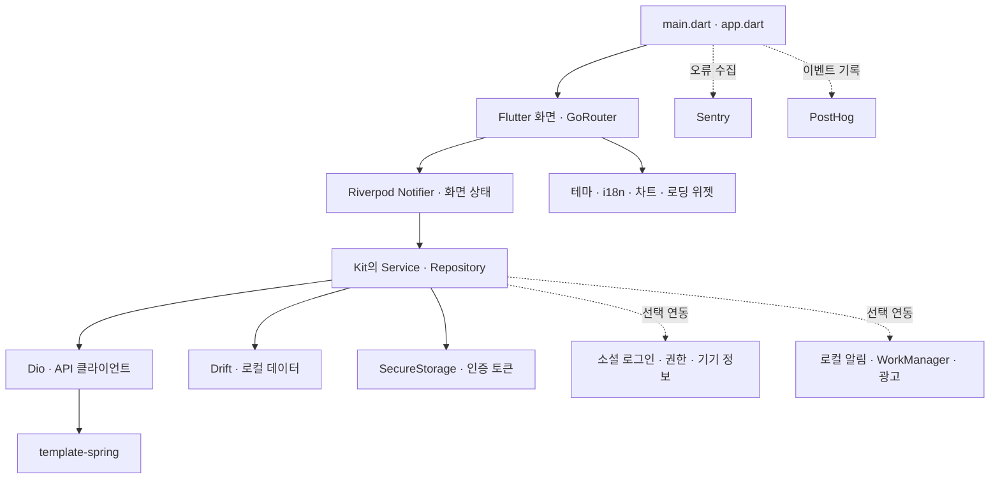

<a id="architecture--한눈-요약"></a>

# Architecture — 한눈 요약

앱을 구성하는 계층과 실행 흐름을 설명해요. 각 계층의 자세한 계약은 [`Module Dependencies`](../architecture/module-dependencies.md), [`FeatureKit Contract`](../architecture/featurekit-contract.md), [ADR](../philosophy/README.md) 에서 확인해요.

---

## 큰 그림

공통 기능을 Kit 으로 나누고 앱에 필요한 Kit 를 조립해요. 테마·저장소 같은 기반은 `core/` 에, 앱 고유 화면은 `features/` 에 둬요.

```text
┌─────────────────────────────────────────────────────┐
│  main.dart + app.dart                                │
│  (엔트리포인트 · MaterialApp)                          │
└─────────────────────────────────────────────────────┘
                         │
     ┌───────────────────┼───────────────────┐
     │                   │                   │
┌────▼────┐         ┌────▼────┐         ┌────▼────┐
│features/│         │ common/ │         │  kits/  │
│         │────────▶│         │────────▶│         │
│ 도메인    │         │ DI · 라우터 │      │ 15개 기능 │
│ (파생)    │         │ · 스플래시 │       │ (선택 조립)│
└────┬────┘         └────┬────┘         └────┬────┘
     │                   │                   │
     └───────────────────┼───────────────────┘
                         │
                   ┌─────▼─────┐
                   │   core/   │
                   │           │
                   │ theme · DI │
                   │ · 저장소 ·  │
                   │ 위젯 · i18n │
                   └───────────┘
```

**단방향 의존**: `features → common → kits → core`. 역방향 금지.

---

## 4 계층 역할

### `core/` (항상 사용)

`core/` 는 여러 앱이 공유하는 기반이에요. Kit 를 조립하는 계약과 테마, 저장소, 공용 위젯 등을 제공해요.

| 모듈 | 핵심 자산 |
|------|----------|
| `theme/` | AppPalette · 디자인 토큰 |
| `storage/` | SecureStorage · SharedPreferences · TokenStorage |
| `cache/` | CacheStore · CachedRepository (5 정책) |
| `widgets/` | PrimaryButton · AppTextField · LoadingView 등 12개 |
| `i18n/` | gen_l10n 결과 (S 클래스) |
| `analytics/` | AnalyticsService · CrashService 추상 + Debug |
| `config/` | AppConfig 싱글톤 |
| `kits/` | AppKit 계약 + AppKits 레지스트리 |
| `utils/` | FormValidators · Debouncer |
| `review/` | 인앱 리뷰 트리거 |

### `kits/` (선택 15개)

`kits/` 에는 앱마다 선택해서 설치하는 기능을 둬요. 활성화 조건과 의존성은 [Features 인덱스](../features/README.md) 에서 확인해요.

- **인프라**: `backend_api_kit`, `file_kit`, `observability_kit`, `local_db_kit`, `notifications_kit`, `background_kit`, `update_kit`, `permissions_kit`, `device_info_kit`
- **UI · UX**: `nav_shell_kit`, `onboarding_kit`, `charts_kit`, `ads_kit`
- **도메인**: `auth_kit` (JWT · 소셜 로그인), `payment_kit` (결제 골격 — 파생 레포에서 SDK 추가)

### `common/` (조립 지점)

| 파일 | 역할 |
|------|------|
| `providers.dart` | 전역 Riverpod Provider 정의 (Kit 들 연결) |
| `router/app_router.dart` | GoRouter + Kit redirect 합성 |
| `splash/splash_controller.dart` | BootStep 순차 실행 |
| `splash/boot_step.dart` | `core/kits/boot_step.dart` 의 re-export (파생 레포 호환용) |

### `features/` (파생 레포 영역)

```text
lib/features/
├── home/             # 홈 화면 예시
├── settings/         # 설정 · 로그아웃 예시
└── profile/          # 프로필 스텁 화면
```

파생 레포에서는 이 영역에 앱 고유 화면을 추가해요. 예를 들어 가계부 앱은 지출과 카테고리 화면을 둘 수 있어요.
```text
lib/features/
├── home/
├── settings/
├── expense/          # ← 예: 가계부 앱
│   ├── list/
│   ├── detail/
│   └── models/
└── category/
```

---

## 상태 관리 흐름

Screen 은 화면을 그리고 사용자 입력을 전달해요. ViewModel 은 화면 상태를 관리하며, 필요한 Service 나 Repository 를 호출해요.

```text
사용자 클릭
  ↓
Screen.onPressed
  ↓
ref.read(viewModelProvider.notifier).someAction()
  ↓
ViewModel (Notifier) 가 Service 호출
  ↓
ref.read(serviceProvider).call()
  ↓
Service 가 Repository · ApiClient 사용
  ↓
응답 / 에러
  ↓
ViewModel: state = state.copyWith(...)
  ↓
Screen: ref.watch 가 state 변화 감지 → 리빌드
```

자세한 건 [`ViewModel + MVVM`](../conventions/viewmodel-mvvm.md).

---

<a id="네트워크-흐름-backend_api_kit-활성-시"></a>

## 네트워크 흐름 (backend_api_kit 활성 시)

```text
ViewModel 이 ApiClient.get('/users/me') 호출
  ↓
AuthInterceptor: Authorization 헤더 자동 첨부
  ↓
실제 HTTP 요청
  ↓
응답 수신
  ↓
AuthInterceptor: 401 이면 refresh 시도 + 재시도 (설치 순 FIFO — Dio 5.x 는 onError 체인도 설치 순)
  ↓
ErrorInterceptor: DioException → ApiException 변환
  ↓
LoggingInterceptor: AppConfig.isDev 일 때 콘솔 출력
  ↓
ViewModel: try/catch 로 수신
```

근거:
- [`ADR-009 · 백엔드 계약`](../philosophy/adr-009-backend-contract.md)
- [`ADR-010 · 401 refresh`](../philosophy/adr-010-queued-interceptor.md)
- [`ADR-011 · 인터셉터 체인`](../philosophy/adr-011-interceptor-chain.md)

---

## 부팅 시퀀스

```text
main()
  ├─ Flutter 바인딩 초기화
  ├─ AppPaletteRegistry.install
  ├─ AppTypefaceRegistry.install
  ├─ AppConfig.init
  ├─ Sentry 래핑 (DSN 주입 시) ── _bootstrap 을 runZonedGuarded 로 wrap
  │
  └─ _bootstrap()
     ├─ PrefsStorage.init
     ├─ AppKits.install([...])      ← Kit 등록 + onInit
     ├─ ProviderContainer 생성
     ├─ AppKits.attachContainer(container)
     ├─ CrashService.init             ← Sentry/Debug 폴백 결정
     ├─ SplashController.run()        ← 모든 Kit 의 BootStep 순차 실행
     └─ runApp(UncontrolledProviderScope)
```

자세한 건 [`Boot Sequence`](../architecture/boot-sequence.md).

---

## 조립 규약

<a id="app_kitsyaml"></a>

### `app_kits.yaml`

```yaml
kits:
  backend_api_kit: {}
  auth_kit: {}
  observability_kit: {}
```

### `lib/main.dart`

```dart
await AppKits.install([
  BackendApiKit(),
  AuthKit(),
  ObservabilityKit(),
]);
```

### 검증

```bash
dart run tool/configure_app.dart
```

YAML 선언과 Dart 조립 코드를 함께 수정한 뒤 검사해요. 도구가 조립 코드를 대신 생성하지는 않아요. 이 방식을 선택한 이유는 [ADR-003](../philosophy/adr-003-featurekit-registry.md) 과 [ADR-004](../philosophy/adr-004-manual-sync-ci-audit.md) 에서 설명해요.

---

## 환경 분리 인프라 (dev/prod flavor)

iOS 의 여섯 Build Configuration 과 Android 의 두 product flavor 로 dev/prod 를 나눠요. dev 앱은 식별자에 `.dev` 를 붙여 prod 앱과 같은 기기에 설치할 수 있어요. Firebase 도 각 환경의 프로젝트와 설정 파일을 연결해 구분해요. 이 구성이 Crashlytics 나 Firebase Analytics 연동까지 제공하는 것은 아니에요.

### Bundle ID 결정 흐름

```text
사용자 입력 (rename-app.sh):  com.example.myapp
                  ↓
ios/Flutter/AppEnv-{dev,prod}.xcconfig:
  BUNDLE_ID_BASE = com.example.myapp       ← 양쪽 동일
  BUNDLE_ID_SUFFIX = .dev                       ← dev 만
  (prod 는 빈 값)
                  ↓
ios/Runner.xcodeproj 의 PRODUCT_BUNDLE_IDENTIFIER:
  $(BUNDLE_ID_BASE)$(BUNDLE_ID_SUFFIX)
                  ↓
빌드 시 flavor 별 자동 결정:
  flutter build --flavor dev   → com.example.myapp.dev
  flutter build --flavor prod  → com.example.myapp
```

Android 도 동일 원리 — `android/app/build.gradle.kts` 의 `productFlavors { dev { applicationIdSuffix = ".dev" } / prod {} }`.

<a id="ios-build-configuration--scheme-구조"></a>

### iOS Build Configuration / Scheme 구조

```text
Build Configurations (6):
  Debug-dev / Release-dev / Profile-dev
  Debug-prod / Release-prod / Profile-prod

Schemes (2 — flutter --flavor 인자가 직접 매칭):
  dev   → Run=Debug-dev, Archive=Release-dev, Profile=Profile-dev
  prod  → Run=Debug-prod, Archive=Release-prod, Profile=Profile-prod

xcconfig 계층:
  Debug-dev.xcconfig
    #include? "Pods-Runner.debug-dev.xcconfig"   (CocoaPods 자동 생성)
    #include "Generated.xcconfig"                (Flutter tooling 생성)
    #include "AppEnv-dev.xcconfig"               (env 분기 변수)
    
  AppEnv-dev.xcconfig (committed — placeholder 값만):
    BUNDLE_ID_BASE / BUNDLE_ID_SUFFIX / APP_ENV
    DISPLAY_NAME_SUFFIX / APP_DISPLAY_NAME       ← 홈 화면 표시 이름 (dev 는 "… (DEV)")
    GID_CLIENT_ID =                              ← 빈 default
    GID_REVERSED_CLIENT_ID =
    #include? "AppEnv-secrets-dev.xcconfig"      ← optional include (gitignored)
    
  AppEnv-secrets-dev.xcconfig (gitignored — link-oauth 생성):
    GID_CLIENT_ID = <PROJECT_NUMBER>-<HASH>.apps.googleusercontent.com   ← link-oauth 가 plist 에서 읽어 채움
    GID_REVERSED_CLIENT_ID = com.googleusercontent.apps.<PROJECT_NUMBER>-<HASH>
```

### Info.plist 변수 substitution

```text
ios/Runner/Info.plist (committed):
  CFBundleIdentifier  = $(PRODUCT_BUNDLE_IDENTIFIER)
  CFBundleDisplayName = $(APP_DISPLAY_NAME)             ← AppEnv-<env>.xcconfig 값
  GIDClientID         = $(GID_CLIENT_ID)                ← AppEnv-secrets-<env>.xcconfig 값
  CFBundleURLSchemes  = $(GID_REVERSED_CLIENT_ID)
```

Xcode 는 빌드할 configuration 의 xcconfig 값을 읽어 `$(VAR)` 를 치환해요. 이때 선택된 값에 따라 Bundle ID 와 Google OAuth 설정이 달라지므로, dev/prod 파일이 올바르게 연결되어 있는지 확인해요.

### 빌드 시 GoogleService-Info.plist 선택

Xcode Build Phase 의 스크립트가 configuration 이름의 `-dev` 또는 `-prod` 를 확인해요. 해당 환경의 `GoogleService-Info-<env>.plist` 를 앱 번들의 `GoogleService-Info.plist` 로 복사하면 Firebase SDK 가 그 파일을 읽어요.

### 운영 흐름

```bash
# 1회 셋업
<repo> dev init        # Firebase dev project + 앱 등록 + plist/json 다운로드 + secrets xcconfig 생성
<repo> prod init       # 동일 흐름의 prod 버전

# 매번 빌드/실행
<repo> dev start       # com.<...>.dev Bundle ID, dev Firebase, dev plist
<repo> prod start      # com.<...> Bundle ID, prod Firebase, prod plist

# Secrets 만 재발급 (OAuth Client ID 갱신 등)
<repo> dev link-oauth          # GoogleService-Info-dev.plist → AppEnv-secrets-dev.xcconfig 재작성
<repo> dev link-oauth --check  # 현재 주입 상태 확인
<repo> dev link-oauth --unlink # secrets 파일 삭제
```

---

## 기술 스택 한눈에 보기

필요한 기능을 선택해 `main.dart`에서 Kit을 조립하고 `app_kits.yaml` 선언을 함께 관리해요. 아래 그림은 사용 가능한 연결을 보여주며 모든 앱이 모든 Kit을 설치한다는 뜻은 아니에요.



Sentry·PostHog는 해당 Kit과 키를 연결했을 때 외부로 전송해요. 키가 없으면 디버그 구현을 사용하며 초기화·기록 범위는 [관측성 Kit](../features/observability-kit.md)에 있어요. FCM 원격 푸시는 로컬 알림 Kit과 별도로 초기화하고 토큰을 등록해요. [FCM 설정](../integrations/fcm.md)을 참고하세요.

정적 분석과 테스트는 Flutter 도구 및 GitHub Actions에서 실행해요. Android 자동 배포는 Fastlane을 사용하고, iOS는 파생 레포에서 서명·업로드 절차를 준비해요. 버전은 다음 표와 실제 `pubspec.yaml`·lockfile을 대조해요.

## 기술 스택

| 영역 | 기술 |
|------|------|
| 프레임워크 | Flutter 3.44.8 (`.fvmrc` 핀, FVM 권장) · Dart `^3.12.0` + flutter `>=3.44.0` (`pubspec.yaml`) |
| 상태관리 | flutter_riverpod 3.4+ (Notifier) |
| 라우팅 | go_router 17.3+ |
| HTTP | dio 5.7+ |
| 로컬 DB | drift 2.34+ · sqlite3 3.5+ (SQLite) |
| 로컬 저장 | shared_preferences · flutter_secure_storage |
| 알림 | flutter_local_notifications · (선택) firebase_messaging |
| 관측성 | sentry_flutter · posthog_flutter |
| i18n | flutter_localizations · intl (gen_l10n) |
| 차트 | fl_chart |
| 광고 | google_mobile_ads (선택) |
| 백엔드 연동 | [`template-spring`](https://github.com/storkspear/template-spring) 짝 |

최소 지원:
- **Android**: `android/app/build.gradle.kts` 는 `flutter.minSdkVersion` 을 사용해요. 고정 숫자로 가정하지 말고 사용 중인 Flutter SDK 와 추가 플러그인의 요구사항을 함께 확인해요.
- **iOS**: 14.0 +

---

## 다음으로 읽을 것

- 더 깊은 모듈 구조: [`Module Dependencies`](../architecture/module-dependencies.md)
- AppKit 계약 상세: [`FeatureKit Contract`](../architecture/featurekit-contract.md)
- Kit 개별 문서: [`Features 인덱스`](../features/README.md)
- 설계 결정 배경: [`Philosophy 인덱스`](../philosophy/README.md)
- 코딩 규약: [`Conventions Overview`](../conventions/README.md)

---

<a id="-책-목차--journey-1단계"></a>

## 📖 책 목차 — Journey 1단계

[`Overview`](./README.md) 의 **1단계** 후반부.

| 방향 | 문서 | 한 줄 |
|---|---|---|
| ← 이전 | [`Philosophy 인덱스`](../philosophy/README.md) | 철학 · 설계 결정 배경 |
| → 다음 | [`Onboarding`](./onboarding.md) | 파생 레포 최초 셋업 (2단계) |
